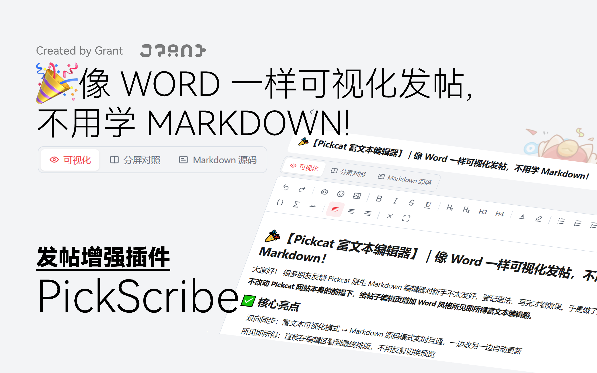

# 🐱 PickScribe · Pickcat 富文本可视化编辑器 + AI 助手

> 一个注入到 Pickcat 的浏览器扩展：
> 在**编辑页**把「写 Markdown 源码」变成「像 Word 一样排版」，和原生 Markdown 源码**双向实时同步**；
> 在**帖子详情页**的分隔线下方提供 **AI 一键总结**，支持 DeepSeek / 豆包 / 通义 / Kimi / 智谱 / 硅基流动 / OpenRouter / 本地 Ollama 等多家模型；
> 在**信息流**里点帖子不跳页，直接浮层预览——文章目录、富文本回复、AI 总结一屏搞定。
> 不改后台、不改提交逻辑，安心用。

[](https://developer.chrome.com/docs/extensions)
[](https://github.com/GrantPome/PickScribe/releases/latest)

> PickScribe 是一个 **Chrome 扩展（Manifest V3）**，不再需要 Tampermonkey。
> 仓库的 `legacy/` 目录仍保留早期油猴脚本 `pickcat-rich-editor.user.js`，但推荐使用扩展版。
> ⚠️ 扩展与油猴脚本**请勿同时启用**，否则会注入两个编辑面板。

---

## 🎉 一句话总结 ##
**让「会写内容」和「会排版」彻底分开——你只管写，排版交给它。**

---

## 😩 你是不是也遇到过这些

- 想加粗一下，却要记住 `**这样写**`，一不小心就漏了星号。
- 想插张图、放个表格，对着 Markdown 语法一脸懵，只能去翻教程。
- 从 Word / 网页复制内容进来，带了一堆乱七八糟的字体、颜色、背景，排版全乱。
- 好不容易写完，预览才发现层级、列表、链接全错了，来回改到崩溃。

**PickScribe 就是为「发帖新手」准备的。** 打开编辑页就能用，零学习成本。

---

## ✨ 核心亮点

| 亮点 | 说明 |
| --- | --- |
| 👀 所见即所得 | 类 Word 的编辑体验，加粗、标题、列表、表格点一下就出来，不用记语法 |
| 🔄 双向实时同步 | 可视化编辑 ↔ Markdown 源码，两边实时同步，改哪边都行，提交的永远是标准 Markdown |
| 🧩 完整适配原生功能 | Kitten 作品分享、表情包、图片、哔哩哔哩视频、表格、链接、公式、任务列表……站点能做的，这里都能做 |
| 🎨 图标用站点原版 | 工具栏图标运行时读取站点原生图标，风格和你熟悉的编辑器**一模一样** |
| 🌗 自动适配深浅色 | 直接复用站点设计变量，浅色 / 深色主题自动跟随，不突兀 |
| 🧹 粘贴自动净化 | 从 Word / 网页粘贴，自动清理冗余样式、剔除危险内容，只留干净排版 |
| 🔍 查找替换 | 三种视图通用，支持逐个 / 全部替换、区分大小写，匹配项高亮且不改动排版 |
| 🎛️ 工具栏三档布局 | 紧凑 / 分组线（仅分割线）/ 功能组（仿 Word）一键循环，选择自动记忆 |
| 🗂️ 同类功能合并 | 标题 H1~H4、对齐方式各自收进一个下拉框；作品 / 表情 / 图片统一归入「插入」分组，工具栏更清爽 |
| 🤖 AI 帖子总结 | 帖子详情页分隔线下方一键总结，流式输出、结果可复制、命中缓存秒出 |
| 🪟 帖子浮层预览 | 信息流里点帖子不跳页，卡片原位放大成浮层（可带 3D 倾斜回正），正文与热门回复一屏看完，关闭后留在原位置；底部横条向上拖即可关闭；卡片悬停支持 3D 视角倾斜，均可在设置关闭 |
| 🧱 信息流网格 | 首页 / 论坛 / 分类页可一键在列表与网格之间切换，一屏多卡、高度对齐，选择自动记忆 |
| 🏠 起始页磁贴 | 每次整页打开首页时铺一屏 Windows 8 风格彩色磁贴：社区精选 + 快捷导航 + 搜索 / 时钟底栏，磁贴尺寸、标签页与各块显隐都能在设置页调整 |
| 🔎 搜索页美化 | 收起站点顶栏与筛选栏，改成「居中 LOGO + 大搜索框 + 筛选胶囊」的窄栏布局；提交与筛选仍代理给站点原控件，结果与分页逻辑不变 |
| 🔔 站内通知转发 | 站内通知可由后台转成系统通知推送，设置页可以发送一条测试通知确认权限正常 |
| 🧭 浮层文章目录 | 左侧固定目录沿用站点结构：整列一条折线、随层级逐级内缩并平滑过渡，当前章节用主题色点亮（14px、38px 行高，长标题可换行），点按钮展开 / 收起并记住状态，点击跳转、随阅读高亮；右侧操作栏可一键返回顶部，标题栏左右箭头按钮可加宽 / 还原窗口，也支持全屏铺满 |
| 🤖 浮层 AI 助手 | 浮层里点标题右侧的「**总结本帖**」，流式输出、可停止；结果占满正文列、可复制或一键填入回复框；面板显隐由右上角「AI 助手」按钮控制 |
| 💬 浮层富文本评论 | 浮层回复框就是所见即所得编辑器，与编辑页共用同一套工具条；全屏评论支持 H1–H4、对齐、颜色、列表、代码块、表格、公式、视频，显示实时字数，图片可直接拖进回复框上传 |
| 🧾 AI 排版 | 编辑页一键把整篇正文整理成规范 Markdown：补齐标题层级、统一空行与列表，保留图片 / 链接 / 公式，预览确认后再整篇应用 |
| 🔌 多家模型可选 | 内置 DeepSeek / 豆包 / 通义 / Kimi / 智谱 / 硅基流动 / OpenRouter / 本地 Ollama，也可自定义任意 OpenAI 兼容接口 |
| 🔤 鸿蒙字体 | 内置 HarmonyOS Sans 可变字体（wght 40–900 连续字重，多语言），安装后整站字体自动换成鸿蒙字体；面板右上角开关，可随时切回原字体 |
| ✍️ 自定义字体 | 设置页可上传自己的字体文件（woff2 / woff / ttf / otf，支持多字重），整站替换；字体只存在本机浏览器里，不上传、不联网、不增大安装包 |
| 🎬 动效优雅 | 浮层、提示、视图切换都带入场动画，长尾缓动、收放自然 |
| 🪶 零依赖轻量 | 纯原生实现，无任何第三方库，加载快、体积小，不拖慢页面 |
| 🔒 密钥只存本地 | API Key 只保存在 `chrome.storage.local`，只发送给你自己配置的接口域名，不上报任何第三方 |
| 🛡️ 安全无侵入 | 只在编辑页 / 详情页挂载面板，不改后端、复用站点原生提交逻辑，停用即恢复原样 |

---

## 🧰 完整适配原有编辑器的全部功能

不是「另起炉灶」，而是把站点原生编辑器能做的**全部**搬到了可视化工具栏里，
点哪个按钮，背后走的就是站点原有的那套逻辑：

- **Kitten 作品分享** —— 一键唤起站点原生作品选择器，上传 / 选图盘逻辑完全一致
- **表情包** —— 直接调用站点原生表情面板，表情库原汁原味
- **图片** —— 复用站点原生图片上传，不再手写 ``
- **哔哩哔哩视频** —— 调用站点原生「插入视频」面板，填 BV/AV 号或视频链接即可，编辑区显示视频占位块，提交时原样写回
- **表格** —— 弹窗填行列数，一键生成，编辑区可视化增删内容
- **链接** —— 选中文字即可加链接，自动补 `target="_blank"` 安全打开
- **公式** —— 支持行内公式 `$...$` 与块级公式 `$$...$$`，最终由站点 KaTeX 渲染
- **任务列表** —— 待办清单，复选框可在编辑区**直接点击**切换完成状态
- **标题 / 加粗 / 斜体 / 删除线 / 下划线 / 引用 / 代码 / 分割线 / 对齐 / 颜色 / 高亮** —— 全部齐活
- **查找替换** —— 工具栏一键展开，匹配项高亮、显示第几项；支持逐个 / 全部替换与区分大小写
- **工具栏布局** —— 紧凑单行 / 分组线（仅分割线）/ 仿 Word 功能组，一键循环切换并记忆选择

> 也就是说：**站点原生编辑器能做的，这里都能做；而且做得更直观。**

---

## 🤖 AI 帖子总结（帖子详情页）

打开任意帖子详情页（`/forum/post/...`），在「作者头像 + 点赞」那条分隔线的**下方**会出现一张 **AI 总结** 卡片：

1. 点卡片里的「**开始总结**」，AI 会读取帖子正文并流式输出要点；
2. 结果可**复制**、可**重新总结**（忽略缓存）、可**折叠**；
3. 想把面板收起来，点右上角「关闭」，本页不再显示（重新打开帖子会再次出现）；
4. 命中缓存时**秒出**，不会重复消耗 token。

> 在信息流里用**浮层**打开帖子时，入口在文章标题行右侧（按钮文字同样是「总结本帖」），
> 输出面板铺满正文列并跟随阅读宽度；浮层里还有「AI 助手」开关可以随时收起面板。

**配置模型**：点扩展图标 → 「打开设置」，或右键扩展图标选择「选项」。

| 配置项 | 说明 |
| --- | --- |
| 服务商 | 内置 DeepSeek、豆包（火山方舟）、通义千问、Kimi、智谱 GLM、硅基流动、OpenRouter、本地 Ollama；也可选「自定义」填任意 OpenAI 兼容地址 |
| 模型名 | 选了服务商后可从下拉候选里挑，也可以手填 |
| API Key | 填你自己在服务商控制台申请的密钥，**只存本地**；本地 Ollama 不需要 |
| 提示词 | 支持自定义系统提示词与用户模板，可用变量 `{{title}}` `{{author}}` `{{content}}` `{{lang}}` `{{length}}` |
| 输出语言 / 长度 | 可选「跟随原文 / 中文 / English」与「短 / 中 / 长」 |
| 触发方式 | **手动点击**（默认）或**打开帖子即自动总结** |
| 流式输出 | 开关；开启后边生成边显示 |

> 保存或「测试连接」时，浏览器会为**你填写的接口域名**申请一次访问权限（之后不再询问）。
> 扩展只申请最小权限：`storage` + 你实际使用的接口域名。

---

## 🚀 怎么用

> **安装前须知**：PickScribe 目前**未上架 Chrome 网上应用店**，需要手动加载安装，
> 因此**必须先开启「开发者模式」**。
>
> **Microsoft Edge 也可以用**：Edge 与 Chrome 同为 Chromium 内核，扩展完全兼容，
> 把下面的 `chrome://extensions/` 换成 `edge://extensions/` 即可，其余步骤一模一样。

**第一步：安装扩展（二选一）**

**方式 A · 下载打包好的 `.zip`（推荐）**

1. 到 [Releases](https://github.com/GrantPome/PickScribe/releases/latest) 下载最新的 `pickcat-rich-editor-extension-3.9.3.zip`（文件名带版本号）
2. 解压到任意目录，得到一个包含 `manifest.json` 的文件夹
3. 打开 `chrome://extensions/`（Edge 为 `edge://extensions/`），右上角开启「**开发者模式**」
4. 点「**加载已解压的扩展程序**」，选择第 2 步解压出的文件夹

**方式 B · 克隆 / 下载仓库源码**

1. 下载或克隆本仓库，找到 `pickcat-rich-editor-extension` 文件夹
2. 打开 `chrome://extensions/`（Edge 为 `edge://extensions/`），右上角开启「**开发者模式**」
3. 点「**加载已解压的扩展程序**」，选择该文件夹

> ⚠️ 开发者模式下，Chrome 每次启动可能提示「请停用以开发者模式运行的扩展程序」，
> 这是加载非商店扩展的正常现象，忽略即可。
>
> 如果你之前装过油猴版脚本，请先在篡改猴里**禁用或删除**它，再装扩展，避免双重注入。

打开任意 Pickcat 帖子编辑页，面板会自动出现在原生编辑器上方。

**第二步：三种视图，随心切换**

- **可视化**：默认模式，像 Word 一样直接排版，最适合新手。
- **分屏对照**：左边写、右边看 Markdown 源码，一边编辑一边学语法。
- **Markdown 源码**：给老手用的，切过去就是原生输入框，两边依然实时同步。

**第三步：写完正常提交即可**

提交时会把最新内容写回原生输入框，走的还是站点原来的提交逻辑，放心。

---

## ⌨️ 顺手记几个快捷键

| 快捷键 | 作用 |
| --- | --- |
| `Ctrl / ⌘ + B` | 加粗 |
| `Ctrl / ⌘ + I` | 斜体 |
| `Ctrl / ⌘ + U` | 下划线 |
| `Ctrl / ⌘ + Z / Y` | 撤销 / 重做 |

选中一段文字，还会弹出**浮动快捷菜单**，加粗、斜体、链接、清除格式随手点。

---

## 📁 文件结构

```
pickscribe/
├── pickcat-rich-editor-extension/       # Chrome 扩展（安装这个）
│   ├── manifest.json                    # Manifest V3 清单（当前 3.9.3）
│   ├── content.js                       # 编辑器主体逻辑（命名空间 pcr）
│   ├── ai/
│   │   ├── content.js                   # 详情页 AI 总结面板（命名空间 pcai）
│   │   └── reply.js                     # 回复框旁的 AI 起草助手（前缀 pcrr）
│   ├── overlay/
│   │   ├── content.js                   # 帖子浮层预览：目录、评论、AI、全屏（命名空间 pco）
│   │   ├── editor.js                    # 浮层评论复用的富文本编辑器
│   │   └── overlay.css                  # 浮层全部样式（pco- 前缀，复用站点 --ui-* 令牌）
│   ├── feed/                            # 信息流列表 / 网格切换（命名空间 pcf）
│   ├── home/                            # 起始页磁贴浮层（pch- 前缀）
│   ├── search/                          # 搜索页美化（命名空间 pcs）
│   ├── level/
│   │   └── content.js                   # 等级成长弹窗三维度与社区熟悉度进度
│   ├── background/
│   │   ├── service-worker.js            # 消息中枢：Port 收发、缓存、通知推送
│   │   ├── llm-client.js                # OpenAI 兼容请求 + SSE 流式解析
│   │   └── notifications.js             # 站内通知 → 系统通知
│   ├── shared/
│   │   ├── constants.js                 # 服务商预设、选择器、默认提示词
│   │   └── storage.js                   # chrome.storage.local 配置与缓存
│   ├── options/                         # 设置页（模型 / 提示词 / 行为 / 外观 / 数据）
│   ├── popup/                           # 扩展图标弹窗（开关 + 快速切模型）
│   ├── fonts/                           # 鸿蒙字体（HarmonyOS Sans VF，多语言 woff2，含 LICENSE）
│   └── icons/                           # 扩展图标
├── docs/                                # 规划与产品文档
│   ├── plan.md                          # AI 总结助手项目规划
│   ├── ai-plugins-plan.md               # AI 插件族（第二辑）规划
│   ├── Pickcat富文本编辑器-产品说明.md    # 早期产品说明
│   ├── pickcat-收藏夹Plus-PRD.html      # 收藏夹 Plus 需求文档
│   └── changelog-post.md                # 发版公告草稿
├── releases/                            # 发布产物（ZIP / CRX / 签名私钥，不纳入版本库）
├── legacy/
│   └── pickcat-rich-editor.user.js      # 早期油猴脚本（保留兼容）
├── assets/
│   └── pickscribe-banner.png            # 宣传图
├── CHANGELOG.md                         # 更新日志（每个版本的改动逐条记录）
└── README.md
```

---

## ❓ 常见问题

**Q：会不会影响网站其他页面？**

A：只有一处影响，而且是刻意的——扩展会给**整个站点**换上鸿蒙字体（HarmonyOS Sans），字体文件随扩展本地加载，不发任何网络请求。如果不想要，点面板右上角的字体开关即可切回站点原字体，选择会被记住。除此之外，只有编辑页会挂载编辑面板、本人主页的「等级成长」弹窗会补上三维度进度，其他页面不会插入任何界面元素。

**Q：AI 总结会不会把我发的内容传到别的服务器？**

A：不会。AI 总结只在你**主动点击**（或你打开了自动总结）时，把你当前这篇帖子的正文发给你**自己在设置里配置的模型接口**；API Key 只存在浏览器的 `chrome.storage.local` 里，扩展不收集、不上报任何数据。如果不想用，在设置或扩展弹窗里关掉「启用 AI 总结面板」即可。

**Q：AI 总结要花钱吗？**

A：取决于你选的服务商。扩展内置了多家**带免费额度**的服务商（如智谱 `glm-4-flash`、硅基流动的免费模型、OpenRouter 上带 `:free` 的模型），也有新用户赠送额度的（豆包 / 通义百炼）。用自己的密钥调用，费用由服务商结算；帖子总结结果会缓存，同一篇不会重复计费。

**Q：为什么保存设置时浏览器弹出权限提示？**

A：因为模型接口域名在安装时是未知的，扩展只声明了「可选权限」。你点保存 / 测试连接时，浏览器才会针对**你填写的那个域名**询问一次，同意后不再询问。扩展仍然只申请 `storage` 与你实际使用的接口域名，不会申请无关权限。

**Q：Google Chrome 上能用，Edge 呢？**

A：可以。Edge 和 Chrome 同为 Chromium 内核，扩展完全兼容，安装时把 `chrome://extensions/` 换成 `edge://extensions/` 即可，其余步骤一样。

**Q：鸿蒙字体支持哪些语言？会不会出现缺字方框？**

A：随扩展内置了官方**可变字体**：拉丁 / 希腊 / 西里尔用 HarmonyOS Sans，中文用 HarmonyOS Sans SC（这份已包含繁体字形），阿拉伯文用 Naskh Arabic；`wght` 轴 40–900 连续可调，400 / 500 / 600 / 700 / 800 都能精确渲染，不再是四档就近替代。遇到字体里确实没有的生僻字符，会自动回退到系统字体，不会出现方框。代码块等宽字体和公式（KaTeX）保持专用字体不变。

字体版权归华为终端有限公司所有，按 HarmonyOS Sans Fonts License Agreement 原样随扩展分发（只做 TTF → WOFF2 无损重封装，未修改字形与字符集），许可全文见 `pickcat-rich-editor-extension/fonts/LICENSE.txt`。

如果更喜欢别的字体，可在设置页「站点外观 → 字体」切到「自定义字体（上传）」，选择本机的 woff2 / woff / ttf / otf 文件，多个字重可一次上传并分别指定。字体字节保存在浏览器的扩展存储（IndexedDB）里，只对当前浏览器生效，不上传、不联网；加载失败时自动回退鸿蒙字体。上传前请自行确认所用字体的授权范围。

**Q：提交的内容会不会和以前不一样？**

A：不会。最终提交的仍是标准 Markdown，和站点原生编辑器完全一致，只是帮你把排版过程变简单了。

**Q：从油猴脚本换到扩展，我原来的内容会丢吗？**

A：不会。编辑器读写的始终是站点原生输入框，扩展只是换了种加载方式，内容不受影响。

**Q：粘贴 Word / 网页内容为什么格式变干净了？**

A：这是刻意的。会白名单过滤掉冗余字体、背景、隐藏元素等，只保留标题、加粗、颜色、链接等有效排版，避免排版错乱。

**Q：我不想用了怎么办？**

A：在 `chrome://extensions/` 里停用或移除扩展，编辑页立刻恢复站点原样，不留任何痕迹。

---

觉得好用的话，欢迎在楼下反馈，也欢迎把 PickScribe 分享给身边被 Markdown 劝退的朋友 🐾